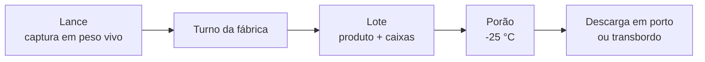
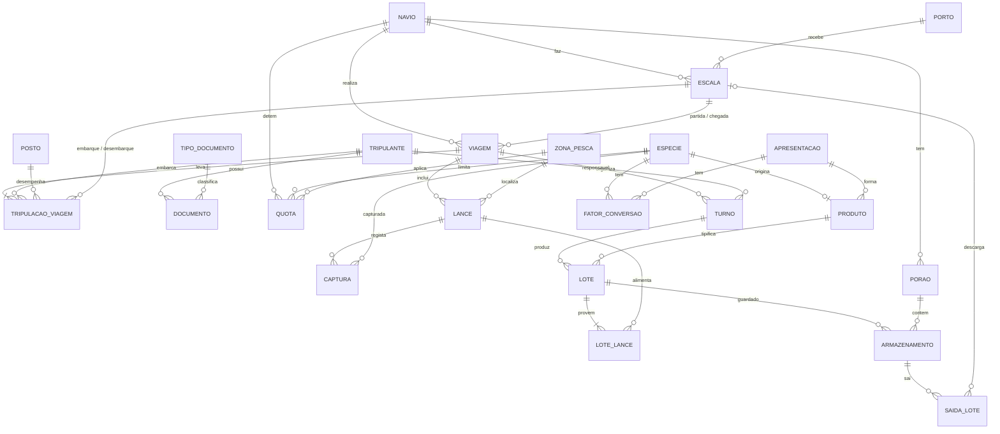

# Base de Dados de um Navio-Fábrica de Pesca

Base de dados relacional em **MySQL** para gerir a operação de um arrastão-fábrica que pesca bacalhau e camarão no Mar da Noruega e em Svalbard. Cobre o navio e as suas escalas, as viagens (marés) e a tripulação, a pesca lance a lance, as quotas, a transformação a bordo em lotes, o armazenamento nos porões e as descargas e transbordos.

Projeto da unidade curricular de **Modelação e Preparação de Dados** — ISCAC | Coimbra Business School, ano letivo 2026/2027.

---

## Índice

- [Contexto](#contexto)
- [Tecnologias](#tecnologias)
- [Estrutura do repositório](#estrutura-do-repositório)
- [Como executar](#como-executar)
- [Modelo de dados](#modelo-de-dados)
- [Regras de negócio](#regras-de-negócio)
- [Vistas, procedimento e índices](#vistas-procedimento-e-índices)
- [Utilizadores e papéis](#utilizadores-e-papéis)
- [Testes](#testes)
- [Dados de teste e RGPD](#dados-de-teste-e-rgpd)
- [Limitações e trabalho futuro](#limitações-e-trabalho-futuro)
- [Autores](#autores)

---

## Contexto

O modelo foi construído a partir de uma entrevista a um tripulante e de documentos reais de operação (lista de tripulação IMO e declaração de chegada SafeSeaNet à Noruega). O navio:

- faz marés de cerca de 6 semanas a partir de Tromsø, com cerca de 24 tripulantes;
- regista a pesca **lance a lance** num diário eletrónico (ERS), em **peso vivo**;
- pesca **bacalhau** (*Gadus morhua*) e **camarão-boreal** (*Pandalus borealis*) nas divisões ICES 2.a e 2.b (ZEE da Noruega e zona de Svalbard);
- processa, congela e embala o peixe a bordo: bacalhau sem cabeça e eviscerado (HEG) e camarão cru inteiro (WHL);
- troca de tripulação em cada nova viagem, mas alguns tripulantes ficam a bordo por opção.

O centro do modelo é o **lote de produção**: liga cada caixa congelada aos lances de onde o peixe veio, o que permite rastrear qualquer caixa até à zona e à data de captura.



## Tecnologias

| Ferramenta | Utilização |
| --- | --- |
| MySQL 8.4 | Sistema de gestão de base de dados |
| Docker / Docker Compose | Servidor MySQL local, igual para todo o grupo |
| DBeaver | Execução de scripts e consulta de dados |
| DbSchema | Diagramas do esquema relacional |

## Estrutura do repositório

```
.
├── docker-compose.yml          # Contentor MySQL 8.4
├── 01_schema.sql               # 23 tabelas, PK, FK, UNIQUE, CHECK e índice da quota
├── 01b_saida_porao.sql         # Migração (só para BD criadas antes de 05/10/2026)
├── 02_dados.sql                # Dados de teste fictícios de uma maré completa
├── 03_triggers.sql             # 7 triggers das regras de negócio
├── 04_testes_triggers.sql      # 18 testes automáticos aos triggers
├── 05_consultas.sql            # Consultas de análise + vistas v_quota_consumo e v_stock
├── 06_indice_explain.sql       # EXPLAIN antes/depois do índice ix_lance_zona_inicio
├── 07_fechar_lote.sql          # Procedimento transacional sp_fechar_lote
├── 08_testes_fechar_lote.sql   # 9 testes ao procedimento (atomicidade)
├── 09_utilizadores.sql         # Papéis (roles) e utilizadores MySQL com GRANT
├── modelo_final.dbs            # Projeto DbSchema (diagramas)
└── README.md
```

## Como executar

### 1. Arrancar o MySQL

Com o Docker Desktop aberto, na pasta do projeto:

```bash
docker compose up -d
docker compose logs -f mysql      # esperar por "ready for connections" e sair com Ctrl+C
```

| Parâmetro | Valor |
| --- | --- |
| Contentor | `MPD_pesca` |
| Host / porta | `localhost:3307` (ver `ports` no `docker-compose.yml`) |
| Base de dados | `sta_princesa` |
| Administração | `root` / `root` (ou `aluno` / `mysql`) |
| Aplicação | um utilizador por papel — ver [Utilizadores e papéis](#utilizadores-e-papéis) |

> As passwords estão no `docker-compose.yml` e no `09_utilizadores.sql` por se tratar de um ambiente local de desenvolvimento. Não usar estas credenciais num servidor real.

### 2. Correr os scripts, por esta ordem

**Windows (PowerShell)** — o `cmd /c` garante que os acentos chegam bem ao MySQL:

```powershell
$scripts = "01_schema.sql", "02_dados.sql", "03_triggers.sql", "04_testes_triggers.sql",
           "05_consultas.sql", "06_indice_explain.sql", "07_fechar_lote.sql",
           "08_testes_fechar_lote.sql", "09_utilizadores.sql"
foreach ($f in $scripts) {
  cmd /c "docker exec -i MPD_pesca mysql -uroot -proot --default-character-set=utf8mb4 --table < $f"
}
```

Ou um de cada vez, por exemplo:

```powershell
cmd /c "docker exec -i MPD_pesca mysql -uroot -proot --default-character-set=utf8mb4 --table < 07_fechar_lote.sql"
```

**Linux / macOS:**

```bash
for f in 01_schema.sql 02_dados.sql 03_triggers.sql 04_testes_triggers.sql \
         05_consultas.sql 06_indice_explain.sql 07_fechar_lote.sql \
         08_testes_fechar_lote.sql 09_utilizadores.sql; do
  docker exec -i MPD_pesca mysql -uroot -proot --default-character-set=utf8mb4 --table < "$f"
done
```

Os scripts 04, 06 e 08 são testes e evidências: podem ser saltados, e deixam os dados como estavam. O 09 tem de correr depois do 05 e do 07, porque dá acesso às vistas e ao procedimento.

Também se podem abrir no **DBeaver** e executar com **Alt+X** (executar script inteiro, não Ctrl+Enter). Os scripts 03, 04, 07 e 08 usam `DELIMITER`; se o DBeaver der erro nessa linha, usar o terminal.

### 3. Verificar

| Script | Resultado esperado no fim |
| --- | --- |
| `01_schema.sql` | `23` tabelas · `34` chaves estrangeiras |
| `02_dados.sql` | COD 42 200 kg · PRA 14 000 kg · stock a bordo dos lotes 4, 6 e 7 |
| `03_triggers.sql` | Lista dos 7 triggers |
| `04_testes_triggers.sql` | 18 testes, todos com resultado `OK` |
| `05_consultas.sql` | Quotas: COD 2.a 4,33 % · COD 2.b NO 5,76 % · COD 2.b Svalbard 3,50 % · PRA 9,33 %; consulta 8 sem linhas |
| `06_indice_explain.sql` | ANTES `ref`, key_len 4, ~16 700 linhas lidas · DEPOIS `range`, key_len 9, 2 linhas · 8 lances no fim |
| `07_fechar_lote.sql` | O procedimento `sp_fechar_lote` |
| `08_testes_fechar_lote.sql` | 9 testes `OK`; no fim 7 lotes, 10 ligações lote–lance, 8 entradas nos porões |
| `09_utilizadores.sql` | Privilégios de escrita de cada papel e os GRANT do `app_fabrica` |

Todos os scripts podem ser corridos mais do que uma vez: o 01 apaga e recria as tabelas, o 02 esvazia-as antes de inserir, o 03 e o 07 apagam os objetos antes de os criar, o 09 apaga e recria os utilizadores, e os testes (04, 06, 08) desfazem ou apagam o que criaram.

**BD criadas antes de 12/10/2026:** não é preciso apagar nada. Basta correr o 03 (trigger corrigido), o 05 (nova vista), o 06 (cria o índice se faltar), o 07 e o 09.

## Modelo de dados

**23 tabelas · 34 chaves estrangeiras**, em quatro áreas:

| Área | Tabelas |
| --- | --- |
| Operação e tripulação | `navio`, `porto`, `escala`, `viagem`, `tripulante`, `posto`, `tripulacao_viagem`, `documento`, `tipo_documento` |
| Pesca e quotas | `especie`, `zona_pesca`, `lance`, `captura`, `quota` |
| Fábrica | `apresentacao`, `produto`, `fator_conversao`, `turno`, `lote`, `lote_lance` |
| Porões e saídas | `porao`, `armazenamento`, `saida_lote` |



Algumas decisões de modelação:

- **Códigos naturais como chave** nas tabelas de referência: FAO (`COD`, `PRA`), apresentação (`HEG`, `WHL`) e UN/LOCODE dos portos (`NOTOS` = Tromsø).
- **Datas e horas em UTC.** A escala guarda as horas previstas (ETA/ETD) e reais (ATA/ATD).
- **Uma viagem começa e acaba numa escala.** A escala de chegada fica `NULL` enquanto o navio está no mar.
- **Tripulação por viagem** (`tripulacao_viagem`): o posto é guardado por viagem, porque um tripulante pode mudar de posto entre marés. `id_escala_desembarque` a `NULL` indica que fica a bordo.
- **Captura em peso vivo**, como no diário ERS. O fator de conversão serve para verificar a produção da fábrica (peso do produto × fator ≈ peso vivo).
- **Lote ↔ lance é N:M:** um lote junta peixe de vários lances e um lance pode dar vários lotes.
- **A saída aponta para o armazenamento** (FK composta `(id_lote, id_porao)`), o que garante que só sai de um porão o que lá esteve guardado.
- **Pesos em `DECIMAL`**, nunca `FLOAT`, para as somas das quotas serem exatas.

## Regras de negócio

| Regra | Descrição | Implementação |
| --- | --- | --- |
| RN2 | O IMO identifica o navio e é único | `UNIQUE (imo)` |
| RN3 | Viagens numeradas por navio | `UNIQUE (id_navio, num_viagem)` |
| RN10 | Um único comandante por viagem | Trigger `trg_tripulacao_comandante` |
| RN16 | Um lote só usa peixe da sua viagem e espécie, sem exceder o capturado | Trigger `trg_lote_lance_viagem` |
| RN19 | Capturas não podem exceder a quota (navio, espécie, zona, ano) | Trigger `trg_captura_quota` |
| RN22 | Um porão não pode exceder a capacidade (entradas − saídas) | Trigger `trg_armazenamento_capacidade` |
| RN24 | Não sai mais stock de um porão do que o que lá está | Trigger `trg_saida_stock` |
| — | Não se guardam mais caixas do que as produzidas pelo lote | Trigger `trg_armazenamento_lote` |
| — | Um lote só usa lances que já tinham terminado no fim do turno | `sp_fechar_lote` (validação) + consulta de controlo 8 |
| RN25 | Uma saída é descarga em porto **ou** transbordo, nunca as duas | `CHECK` com XOR + FK composta |
| RN26 | Peso do produto ≤ peso da matéria-prima | `CHECK` |
| RN28 | O responsável do turno é Factory Manager ou 2nd Factory Manager | Trigger `trg_turno_responsavel` |
| RN30 | Uma só apresentação por espécie neste navio | `UNIQUE (cod_fao)` em `produto` |

Os triggers são `BEFORE INSERT` e recusam operações inválidas com `SIGNAL SQLSTATE '45000'` e uma mensagem que explica o problema, por exemplo:

```
RN19: quota excedida (COD): restam 381700.00 kg, pedido 390000.00 kg
```

## Vistas, procedimento e índices

**Vistas** (`05_consultas.sql`):

| Vista | O que dá | Usada em |
| --- | --- | --- |
| `v_quota_consumo` | Por quota: capturado, restante, % consumida e estado (OK / ATENÇÃO ≥ 75 % / CRÍTICO ≥ 90 %) | Painel de quotas (UI04), consulta 2 |
| `v_stock` | Stock de cada lote em cada porão (entradas − saídas) | Stock e saídas (UI03), consultas 4a–4c |

A `v_quota_consumo` faz exatamente o mesmo cálculo que o trigger `trg_captura_quota`, por isso o painel que avisa e o trigger que recusa nunca dão valores diferentes.

**Procedimento transacional** `sp_fechar_lote` (`07_fechar_lote.sql`), chamado pelo ecrã UI02: cria o lote, liga-o aos lances de origem e guarda as caixas nos porões numa só transação. Se um trigger, uma FK ou um CHECK recusar qualquer passo, faz `ROLLBACK` e devolve a mensagem original. Lances e porões chegam como arrays JSON:

```sql
CALL sp_fechar_lote('SP-T12-COD-001', 9, 1, 80,
     '[{"id_lance": 11, "peso_vivo_kg": 3000}]',
     '[{"id_porao": 1, "n_caixas": 50}, {"id_porao": 2, "n_caixas": 30}]',
     NULL, @id_lote);
SELECT @id_lote;
```

O procedimento calcula a matéria-prima (soma dos lances) e o peso do produto (caixas × peso por caixa). Começa por bloquear os lances com `SELECT … FOR UPDATE`: dois fechos de lote simultâneos com o mesmo lance ficam em fila, e o segundo é recusado pela RN16 se o peixe já tiver sido usado.

**Índice** `ix_lance_zona_inicio (id_zona_pesca, inicio)` (`01_schema.sql`): o trigger da quota e a `v_quota_consumo` filtram o ano por intervalo de datas (`inicio >= '2026-01-01' AND inicio < '2027-01-01'`) e não por `YEAR(inicio)`, que impedia o uso do índice. Com 50 000 lances de carga (`06_indice_explain.sql`):

| Filtro | Plano | Linhas lidas |
| --- | --- | --- |
| `YEAR(inicio) = 2026` | `ref`, key_len 4 (só a zona) | 16 668 |
| `inicio >= … AND inicio < …` | `range`, key_len 9 (zona + data) | 2 |

O índice substitui o índice automático da FK da zona, porque começa pela mesma coluna. A tabela não fica com um índice a mais.

## Utilizadores e papéis

O `09_utilizadores.sql` cria um **role** MySQL por papel e um utilizador por role. A aplicação liga-se com o utilizador do papel de quem entrou e lê as credenciais do ficheiro `.env`, fora do Git.

| Papel | Utilizador | Palavra-passe (demonstração) | Pode escrever em |
| --- | --- | --- | --- |
| Comandante | `app_comandante` | `Comandante-2026` | escalas, viagens, tripulação, documentos, saídas |
| Mestre de pesca | `app_pesca` | `Pesca-2026` | lances e capturas |
| Responsável de fábrica | `app_fabrica` | `Fabrica-2026` | turnos; lotes **só** pelo `sp_fechar_lote` |
| Armador | `app_armador` | `Armador-2026` | quotas |

Todos leem todas as tabelas e vistas, **exceto** a tabela `documento` (passaportes e vistos), que só o comandante lê (RGPD). Os `UPDATE` são dados **por coluna**, só em colunas sem regras de quantidade (horas reais da escala, fim do lance ou do turno, valor da quota), para um `UPDATE` não contornar os triggers, que só validam `INSERT`.

Para mostrar na defesa (PowerShell):

```powershell
# Recusado: o mestre de pesca não pode mudar a zona de um lance (conta para outra quota)
docker exec -i MPD_pesca mysql -uapp_pesca '-pPesca-2026' sta_princesa -e "UPDATE lance SET id_zona_pesca = 3 WHERE id_lance = 1"

# Recusado: a fábrica não pode criar lotes fora do procedimento
docker exec -i MPD_pesca mysql -uapp_fabrica '-pFabrica-2026' sta_princesa -e "INSERT INTO lote (codigo_lote, id_turno, id_produto, n_caixas, peso_liquido_kg, peso_materia_prima_kg) VALUES ('X', 1, 1, 1, 1, 1)"

# Recusado: só o comandante lê os documentos da tripulação
docker exec -i MPD_pesca mysql -uapp_fabrica '-pFabrica-2026' sta_princesa -e "SELECT numero FROM documento"

# Aceite: o armador lê o painel de quotas
docker exec -i MPD_pesca mysql -uapp_armador '-pArmador-2026' sta_princesa -e "SELECT * FROM v_quota_consumo"
```

## Testes

| Script | Testes | Como |
| --- | --- | --- |
| `04_testes_triggers.sql` | 18 (os 7 triggers, casos aceites e recusados) | Uma transação desfeita no fim (`ROLLBACK`) |
| `08_testes_fechar_lote.sql` | 9 (`sp_fechar_lote`: 2 aceites, 7 recusados) | Cria dados de teste na Trip 12 e apaga-os no fim |
| Privilégios | 17 verificados a 12/10 (4 deles nos comandos acima) | Ligação com cada utilizador |

O ponto principal do 08 é a coluna **gravado**. Num caso recusado tem de ser `nada`, mesmo quando o erro acontece no 2.º ou no 3.º passo, depois de o lote já ter sido inserido.

Resultado atual: **18/18 OK** (04) e **9/9 OK** (08).

## Dados de teste e RGPD

O `02_dados.sql` contém uma maré completa (Trip 11, de 12/07 a 24/08/2026) e o início da seguinte (Trip 12, ainda no mar): 14 tripulantes, 8 lances nas três zonas, 4 quotas, 7 turnos, 7 lotes, armazenamento em dois porões, um transbordo e uma descarga em Tromsø.

**Todos os dados são fictícios** — nomes, documentos, IMO, MMSI e quantidades. Os documentos reais usados no levantamento de requisitos contêm dados pessoais da tripulação (nomes, datas de nascimento, passaportes) e **não fazem parte deste repositório**.

Valores de exemplo a confirmar com o armador: peso por caixa (25 kg bacalhau, 20 kg camarão) e fator de conversão do bacalhau HEG (1,50).

## Limitações e trabalho futuro

- Os triggers cobrem só `INSERT`. Os utilizadores da aplicação só podem fazer `UPDATE` em colunas sem regras de quantidade, mas um administrador (`root`) ainda pode contornar as regras com um `UPDATE`. Solução completa: triggers `BEFORE UPDATE` com a mesma lógica.
- O armador pode baixar uma quota para menos do que já foi capturado. O painel mostra-a acima de 100 %, mas nada o impede.
- A Trip 12 ainda não tem lances nem turnos no seed. Para demonstrar o UI02 no protótipo, é preciso registar primeiro um lance e um turno (ou acrescentá-los ao seed).
- Ficaram fora do âmbito: combustível, resíduos MARPOL, provisões, equipamentos da fábrica, registo de temperatura dos porões e congelação dos lotes.
- Triggers opcionais por implementar: numeração automática de viagens e lances, e validação das datas dos lances face às da viagem.

## Autores

| Nome | N.º de estudante |
| --- | --- |
| Rodrigo | |
| | |

Unidade curricular de Modelação e Preparação de Dados · ISCAC | Coimbra Business School · 2026/2027

