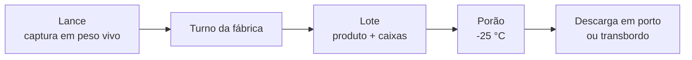

# Base de Dados do Navio-Fábrica "Santa Princesa"

Base de dados relacional em **MySQL 8.4** e protótipo web para gerir a operação de um arrastão-fábrica que pesca bacalhau e camarão-boreal no Mar da Noruega e em Svalbard: escalas, viagens (marés) e tripulação, pesca lance a lance, quotas, transformação a bordo em lotes, armazenamento nos porões e descargas ou transbordos.

Projeto da unidade curricular de **Modelação e Preparação de Dados** — Mestrado em Análise de Dados e Sistemas de Apoio à Decisão, ISCAC | Coimbra Business School, ano letivo 2026/2027.

---

## Índice

- [Objetivo](#objetivo)
- [Pré-requisitos](#pré-requisitos)
- [Configurar a base de dados](#configurar-a-base-de-dados)
- [Configurar e executar a aplicação](#configurar-e-executar-a-aplicação)
- [Credenciais de demonstração](#credenciais-de-demonstração)
- [Estrutura do projeto](#estrutura-do-projeto)
- [Modelo de dados](#modelo-de-dados)
- [Regras de negócio e lógica da base de dados](#regras-de-negócio-e-lógica-da-base-de-dados)
- [Testes](#testes)
- [Dados de teste e RGPD](#dados-de-teste-e-rgpd)
- [Limitações](#limitações)
- [Autores](#autores)

---

## Objetivo

Uma base de dados relacional que registe a operação do navio por maré e garanta a **rastreabilidade do peixe desde o lance de pesca até à caixa descarregada**, com as regras de negócio garantidas na própria base de dados. O centro do modelo é o **lote de produção**, que liga cada caixa congelada aos lances de onde o peixe veio.



O **protótipo** (Node.js + Express) lê e escreve diretamente nesta base de dados, com um utilizador MySQL por papel. Tem seis ecrãs: Painel de quotas (UI04), Registar lance e capturas (UI01), Fechar lote (UI02), Stock e saídas (UI03), Rastrear uma caixa (UI05) e Viagens e escalas (FR13).

Problema, utilizadores e âmbito: [`documentation/project-brief.md`](documentation/project-brief.md).

## Pré-requisitos

| Ferramenta | Versão | Para quê |
| --- | --- | --- |
| Docker Desktop (Docker Compose) | atual | servidor MySQL local, igual para todo o grupo |
| MySQL | 8.4 (imagem `mysql:8.4`) | SGBD — corre dentro do contentor |
| Node.js | 25.6 (mínimo 22.12) | protótipo; inclui o npm |
| PowerShell | 5.1 ou superior (Windows) | script `data/executar_tudo.ps1` |
| DBeaver e DbSchema | opcionais | consultas e diagramas |

Versões fixas da aplicação e arquitetura: [`documentation/technical-stack.md`](documentation/technical-stack.md).

## Configurar a base de dados

### 1. Arrancar o MySQL

Com o Docker Desktop aberto, na pasta do projeto:

```bash
docker compose up -d
docker compose logs -f mysql      # esperar por "ready for connections" e sair com Ctrl+C
```

| Parâmetro | Valor |
| --- | --- |
| Contentor | `MPD_pesca` |
| Host / porta | `localhost:3307` (ver `ports` no `docker-compose.yml`) |
| Base de dados | `sta_princesa` |

### 2. Criar a base de dados

Os scripts estão em `data/` e correm por esta ordem:

| # | Ficheiro | Conteúdo |
| --- | --- | --- |
| 1 | `data/schema.sql` | cria a BD `sta_princesa`: 23 tabelas, 34 FK, 11 UNIQUE, 16 CHECK e o índice `ix_lance_zona_inicio` |
| 2 | `data/seed.sql` | dados de teste fictícios (Viagem 11 completa e o início da Viagem 12) |
| 3 | `data/views.sql` | vistas `v_quota_consumo` e `v_stock` |
| 4 | `data/programmable_objects.sql` | 14 triggers, procedimentos `sp_fechar_lote` e `sp_validar_chegada_viagem`, papéis e utilizadores MySQL |

**Windows (recomendado)** — o script corre os quatro pela ordem certa e mostra as verificações:

```powershell
.\data\executar_tudo.ps1            # cria a BD com os dados de teste
.\data\executar_tudo.ps1 -Testes    # e corre os testes automáticos de data/testes/
```

O script lê a palavra-passe de root dentro do contentor e envia os ficheiros ao MySQL sem alterar a codificação (o `<` do PowerShell estragava os acentos). Serve também para **repor os dados de teste** depois de usar o protótipo.

**Linux / macOS:**

```bash
for f in schema seed views programmable_objects; do
  docker exec -i MPD_pesca sh -c 'mysql -uroot -p"$MYSQL_ROOT_PASSWORD" --default-character-set=utf8mb4 --table' < "data/$f.sql"
done
```

Também se podem abrir no **DBeaver** e executar com **Alt+X** (script inteiro). O `programmable_objects.sql` e os testes usam `DELIMITER`; se o DBeaver der erro nessa linha, usar o terminal.

Todos os scripts podem ser corridos mais do que uma vez: o schema apaga e recria as tabelas, o seed esvazia-as antes de inserir, as vistas, os triggers e os procedimentos são recriados, e os utilizadores apagados e criados de novo.

### 3. Verificar

| Ficheiro | Resultado esperado no fim |
| --- | --- |
| `schema.sql` | `23` tabelas · `34` chaves estrangeiras |
| `seed.sql` | COD 42 200 kg · PRA 14 000 kg · stock a bordo dos lotes 4, 6 e 7 |
| `views.sql` | as 2 vistas |
| `programmable_objects.sql` | lista dos 14 triggers, o procedimento e os privilégios de cada papel |
| `queries.sql` (opcional) | painel: COD 2.a 4,33 % · COD 2.b NO 5,76 % · COD 2.b Svalbard 3,50 % · PRA 9,33 %; Q17 sem linhas |

## Configurar e executar a aplicação

Depois de criada a base de dados, na pasta `application`:

```powershell
Copy-Item .env.example .env     # só na primeira vez; ajustar se a porta não for 3307
npm install                     # instala express e mysql2 (versões do package-lock.json)
npm run verificar               # liga-se com os 4 utilizadores e mostra OK / FALHOU
npm start                       # http://localhost:3000   (ou npm run dev durante o desenvolvimento)
```

Abrir http://localhost:3000. Cada ecrã usa o utilizador MySQL do seu papel; a barra lateral mostra o utilizador e a viagem em curso. Detalhes da API e dos ecrãs: [`application/README.md`](application/README.md).

Os dados registados no protótipo ficam na BD. Para voltar aos dados de teste: `.\data\executar_tudo.ps1`.

## Credenciais de demonstração

A aplicação não tem ecrã de login: cada ecrã liga-se com o utilizador MySQL do seu papel, lido do ficheiro `application/.env` (fora do Git). Os valores de demonstração estão no `application/.env.example`:

| Papel | Utilizador MySQL | Palavra-passe (demonstração) | Pode escrever em | Ecrãs |
| --- | --- | --- | --- | --- |
| Comandante | `app_comandante` | `Comandante-2026` | escalas, viagens, tripulação, documentos, saídas | UI03, Viagens e escalas |
| Mestre de pesca | `app_pesca` | `Pesca-2026` | lances e capturas | UI01 |
| Responsável de fábrica | `app_fabrica` | `Fabrica-2026` | turnos; lotes **só** pelo `sp_fechar_lote` | UI02 |
| Armador | `app_armador` | `Armador-2026` | quotas | UI04, UI05 |

Todos leem as tabelas e as vistas, **exceto** `documento` (passaportes e vistos), que só o comandante lê (RGPD). Os `UPDATE` são dados por coluna, só em colunas sem regras de quantidade.

Administração da BD local: `root` / `root` (definido no `docker-compose.yml`). **Todas estas credenciais são de demonstração, para o ambiente local em Docker**; nenhuma está escrita no código da aplicação.

## Estrutura do projeto

Segue a estrutura do Guia do projeto; os ficheiros marcados com (+) são acrescentos.

```
.
├── data/
│   ├── schema.sql                  # DDL: tabelas, PK, FK, UNIQUE, CHECK, índice
│   ├── seed.sql                    # dados de teste fictícios
│   ├── queries.sql                 # 17 consultas de análise (Q01–Q17)
│   ├── views.sql                   # v_quota_consumo, v_stock
│   ├── programmable_objects.sql    # triggers, procedimentos, papéis e utilizadores
│   ├── executar_tudo.ps1           # (+) cria a BD pela ordem certa (e corre os testes)
│   └── testes/                     # (+) testes automáticos e EXPLAIN do índice
│       ├── testes_triggers.sql     #     33 testes aos triggers
│       ├── testes_fechar_lote.sql  #     9 testes ao sp_fechar_lote (atomicidade)
│       ├── testes_restricoes.sql   #     6 testes a CHECK, UNIQUE e FK composta
│       └── indice_explain.sql      #     EXPLAIN antes/depois do índice
├── application/                    # protótipo Node.js + Express (ver application/README.md)
├── documentation/
│   ├── project-brief.md
│   ├── requirements.md             # FR01–FR13
│   ├── business-rules.md           # BR01–BR20
│   ├── technical-stack.md
│   ├── data-dictionary.csv         # 114 atributos
│   ├── ai-use-summary.md           # AI-01 a AI-04
│   ├── diagrams/ERD_sta_princesa.png
│   ├── mockups/                    # UI01–UI05 (PNG + HTML editável)
│   ├── evidencias/                 # (+) capturas do protótipo
│   ├── GUIAO_CAPTURAS.md           # (+) sequência para refazer as capturas
│   └── NOTAS_RELATORIO.md          # (+) alterações a passar para o relatório
├── docker-compose.yml              # (+) contentor MySQL 8.4
├── CLAUDE.md                       # (+) contexto do projeto para o Claude Code
├── ESTADO_DO_PROJETO.md            # (+) ponto de situação e decisões do grupo
└── README.md
```

## Modelo de dados

**23 tabelas · 34 chaves estrangeiras**, em quatro áreas. ERD completo: [`documentation/diagrams/ERD_sta_princesa.png`](documentation/diagrams/ERD_sta_princesa.png); dicionário de dados: [`documentation/data-dictionary.csv`](documentation/data-dictionary.csv).

| Área | Tabelas |
| --- | --- |
| Operação e tripulação | `navio`, `porto`, `escala`, `viagem`, `tripulante`, `posto`, `tripulacao_viagem`, `documento`, `tipo_documento` |
| Pesca e quotas | `especie`, `zona_pesca`, `lance`, `captura`, `quota` |
| Fábrica | `apresentacao`, `produto`, `fator_conversao`, `turno`, `lote`, `lote_lance` |
| Porões e saídas | `porao`, `armazenamento`, `saida_lote` |

Decisões de modelação:

- **Códigos naturais como chave** nas tabelas de referência: FAO (`COD`, `PRA`), apresentação (`HEG`, `WHL`) e UN/LOCODE dos portos (`NOTOS` = Tromsø).
- **Datas e horas em UTC.** A escala guarda as horas previstas (ETA/ETD) e reais (ATA/ATD).
- **Uma viagem começa e acaba numa escala.** A escala de chegada fica `NULL` enquanto o navio está no mar: a data de chegada não precisa de ser conhecida quando a viagem começa.
- **Número da viagem vs. identificador:** `num_viagem` é o número usado a bordo (Viagem 11, Viagem 12); `id_viagem` é só a chave técnica. Os ecrãs mostram sempre o número.
- **Tripulação por viagem** (`tripulacao_viagem`): o posto é guardado por viagem; `id_escala_desembarque` a `NULL` indica que fica a bordo.
- **Captura em peso vivo**, como no diário ERS; o fator de conversão verifica a produção da fábrica.
- **Lote ↔ lance é N:M:** um lote junta peixe de vários lances e um lance pode dar vários lotes.
- **A saída aponta para o armazenamento** (FK composta `(id_lote, id_porao)`): só sai de um porão o que lá esteve guardado.
- **Código do lote** (impresso na caixa): `SP-T<n.º da viagem>-<espécie>-<sequência>`, por exemplo `SP-T12-COD-001`.
- **Pesos em `DECIMAL`**, nunca `FLOAT`, para as somas das quotas serem exatas.

## Regras de negócio e lógica da base de dados

As 20 regras estão em [`documentation/business-rules.md`](documentation/business-rules.md) (BR01–BR20, com o código RN usado nas mensagens) e são todas garantidas na base de dados:

- **Restrições** (`schema.sql`): 11 UNIQUE, 16 CHECK e a FK composta da saída.
- **14 triggers** (`programmable_objects.sql`, parte 1): quota (BR08), origem do lote (BR10), caixas e capacidade dos porões (BR13), stock nas saídas (BR14), responsável do turno (BR12), um só comandante (BR06), datas dos lances e das escalas (BR17, BR18), fecho e abertura da viagem (BR19, BR20). Recusam com `SIGNAL SQLSTATE '45000'` e uma mensagem começada pelo código da regra, por exemplo `RN19: quota excedida (COD): restam 381700.00 kg, pedido 390000.00 kg`.
- **Procedimento transacional** `sp_fechar_lote` (parte 2): cria o lote, liga-o aos lances de origem e guarda as caixas nos porões numa só transação, com `ROLLBACK` + `RESIGNAL` em qualquer erro e `SELECT … FOR UPDATE` nos lances.
- **Papéis e utilizadores** (parte 3): um role MySQL por papel, privilégios mínimos e `UPDATE` por coluna.
- **Vistas** (`views.sql`): `v_quota_consumo` (mesmo cálculo do trigger da quota; painel UI04) e `v_stock` (stock por lote e porão; UI03, UI05).
- **Índice** `ix_lance_zona_inicio (id_zona_pesca, inicio)`: o filtro do ano é um intervalo de datas e não `YEAR(inicio)`. Com 50 000 lances de carga (`data/testes/indice_explain.sql`): de `ref`, 16 668 linhas lidas, para `range`, 2 linhas.

O protótipo também abre transações (`beginTransaction` / `commit` / `rollback`) para as operações de vários passos: lance + capturas (UI01), chegada + fecho da viagem + desembarques, e partida + nova viagem + tripulação (Viagens e escalas).

## Testes

| Script | Testes | Como |
| --- | --- | --- |
| `data/testes/testes_triggers.sql` | 33 (os 14 triggers, casos aceites e recusados) | uma transação desfeita no fim (`ROLLBACK`) |
| `data/testes/testes_fechar_lote.sql` | 9 (`sp_fechar_lote`: 2 aceites, 7 recusados) | cria dados de teste na Viagem 12 e apaga-os no fim |
| `data/testes/testes_restricoes.sql` | 6 (TC18–TC20, TC23–TC25: CHECK, UNIQUE, FK composta) | uma transação desfeita no fim |

Todos correm com `.\data\executar_tudo.ps1 -Testes`. Resultado atual: **33/33**, **9/9** e **6/6 OK**. Os testes de triggers usam ids fixos: depois de usar o protótipo, repor os dados antes de os correr.

Os testes do protótipo (TC26–TC30 e TC44–TC83) estão descritos no relatório e em `documentation/NOTAS_RELATORIO.md`; o `documentation/GUIAO_CAPTURAS.md` reproduz os principais no ecrã.

## Dados de teste e RGPD

O `data/seed.sql` contém uma maré completa (Viagem 11, de 12/07 a 24/08/2026) e o início da seguinte (Viagem 12, ainda no mar): 14 tripulantes, 8 lances nas três zonas, 4 quotas, 7 turnos, 7 lotes, armazenamento em dois porões, um transbordo e quatro descargas em Tromsø.

**Todos os dados são fictícios** — nomes, documentos, IMO, MMSI e quantidades. Os documentos reais usados no levantamento contêm dados pessoais da tripulação e **não fazem parte deste repositório**.

Valores de exemplo a confirmar com o armador: peso por caixa (25 kg bacalhau, 20 kg camarão) e fator de conversão do bacalhau HEG (1,50).

## Limitações

- Os triggers de quantidades (BR08, BR10, BR13, BR14) cobrem só `INSERT`; as datas dos lances e das escalas e o fecho da viagem têm também triggers `BEFORE UPDATE`. Os utilizadores da aplicação só podem fazer `UPDATE` em colunas sem regras de quantidade, mas o `root` ainda pode contornar as regras com um `UPDATE`.
- O armador pode baixar uma quota para menos do que já foi capturado; o painel mostra-a acima de 100 %.
- Só a aplicação verifica que um lance não começa antes da partida da viagem; os turnos ainda aceitam datas no futuro; as datas das saídas só têm avisos no ecrã.
- Corrigir a ATA de uma escala que já é a chegada de uma viagem fechada não volta a validar o fecho. A BR20 não verifica que a partida é depois da chegada anterior quando as escalas são diferentes, e a BD não obriga a que uma viagem tenha comandante ou Factory Manager (o ecrã avisa).
- O protótipo não tem ecrã de login: o papel é escolhido pelo ecrã.
- Ficaram fora do âmbito: combustível, resíduos MARPOL, provisões, equipamentos da fábrica, registo de temperatura dos porões e congelação dos lotes.

## Autores

| Nome | N.º de estudante |
| --- | --- |
| Rodrigo Pereira | |
| Hugo Grou | |
| Marcelo Manteigas | |
| Martim Ferreira | |

Unidade curricular de Modelação e Preparação de Dados · Docente: Prof. Doutor Adriano Lino · ISCAC | Coimbra Business School · 2026/2027
